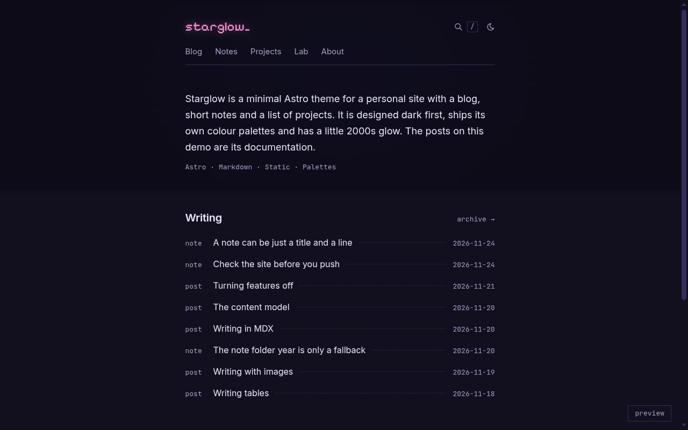
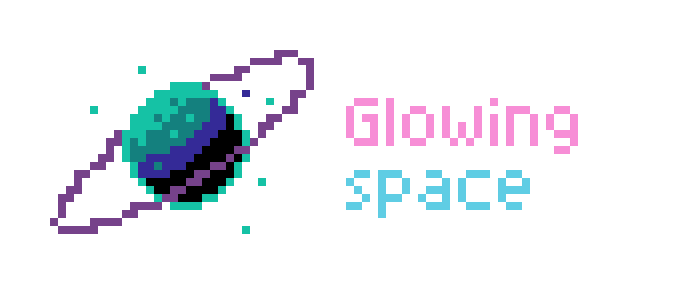

# Starglow

A minimal, developer-flavoured Astro theme for blogs, notes and projects.
Dark first, its own colour palettes, a little 2000s glow.

<picture>
  <source media="(prefers-color-scheme: light)" srcset=".github/assets/screenshot-light.png">
  
</picture>

**[Live demo](https://starglow.glowing.space)** · [Docs](https://starglow.glowing.space/blog/) · [Changelog](CHANGELOG.md)

## Features

- Posts, short notes, projects and a lab of experiments, with tags and related content
- Banded page header with an optional ambient glow and a pixel wordmark
- Labelled code, table and callout blocks; GitHub alert callouts; MDX
- Vim-style statusline on posts, 88x31 footer badges, a terminal 404 page
- Pagefind search, RSS, sitemap, generated Open Graph images, JSON-LD
- 4 dark and 5 light palettes, chosen separately; your own in a few lines; WCAG AA checked at build
- A live preview panel for demos: palette, ambient light, glow, statusline
- Almost no client JavaScript; plain static `dist/` for any host
- One typed config file, `starglow.config.ts`
- Build checks: every route, canonical URL, search index and link is asserted after each build

## Quick start

```sh
npm create astro@latest -- --template glowing-space/starglow
cd <your-site>
pnpm install
pnpm dev            # http://localhost:4321
```

Prefer Docker? `./dev.sh` runs the same dev server with only Docker on the
host.

Then:

1. Set your details in [`starglow.config.ts`](starglow.config.ts).
2. Set your origin: `SITE_URL=https://example.com pnpm build` (or in `.env`).
3. Replace the example posts in `src/content/` with your own.
   `./dev.sh new post my-first-post` scaffolds one.

## Commands

| Command        | What it does                                          |
| -------------- | ----------------------------------------------------- |
| `pnpm dev`     | Dev server with drafts visible                        |
| `pnpm build`   | `astro check`, build, search index, placeholder check |
| `pnpm preview` | Serve the built `dist/`                               |
| `pnpm verify`  | Assertions over `dist/`                               |
| `./dev.sh ci`  | Every CI check locally, in Docker                     |

The full list, authoring rules and the config reference are in
[docs/DEVELOPMENT.md](docs/DEVELOPMENT.md).

## Customise

| I want to change…              | Edit                                           |
| ------------------------------ | ---------------------------------------------- |
| Title, author, socials, badges | `starglow.config.ts`                           |
| Header glow, statusline        | `appearance` in `starglow.config.ts`           |
| Colours                        | `appearance.palette` / `palettes`              |
| Fonts, spacing                 | `src/styles/site-theme.css`                    |
| Extra `<head>` tags, analytics | `src/custom/Head.astro`                        |
| Comments or a bio under posts  | `src/custom/PostEnd.astro`                     |
| The footer credit              | `footer.credit: false` in `starglow.config.ts` |

Files in `src/custom/` are yours: upgrades never change them. See
[UPGRADING.md](UPGRADING.md).

## Deploy

The build output is plain static files in `dist/`. The included workflow
deploys to GitHub Pages; Cloudflare Pages, Netlify and others work with
build command `pnpm build` and output directory `dist`. Set `SITE_URL` to
your origin.

## Contributing

Issues and pull requests are welcome. Read [CONTRIBUTING.md](CONTRIBUTING.md)
first; security issues go through [SECURITY.md](SECURITY.md).

## Credits



Made by [Andrii Filiurskyi](https://github.com/filiurskyi), a
[glowing.space](https://glowing.space) project.

Originally based on [AstroPaper](https://github.com/satnaing/astro-paper) by
Sat Naing. The glowing palette takes its colours from the glowing.space logo. Fonts: Inter,
JetBrains Mono and Pixelify Sans (SIL OFL). See [NOTICE](NOTICE).

## Licence

[MIT](LICENSE). Keeping the "powered by starglow" footer credit is
appreciated, not required.
