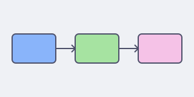

Put images next to the post, in a folder whose name starts with `_`, such as `_assets/`. Astro optimises them at build time, and the underscore keeps the folder out of the content loader.

```md

```

## Figure


_Figure 1: three boxes joined by arrows. A caption is an italic line right under the image._

## Alt text

Every image needs alt text that describes what it shows. `pnpm verify` fails on an image without it. If an image is purely decorative, leave it out of the post instead.

## Social images

A post's social preview image is generated from its title by default. To use your own, put an image next to the post and set `ogImage: ./_assets/cover.png` in the frontmatter.
